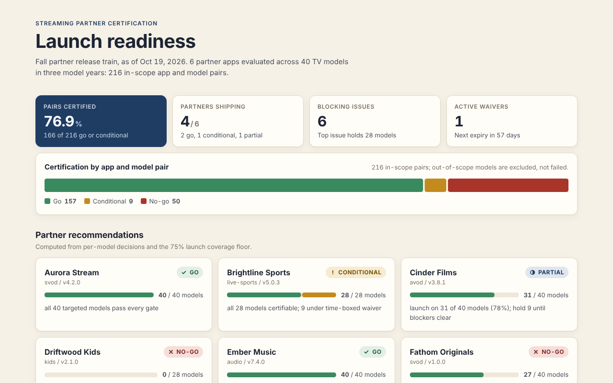
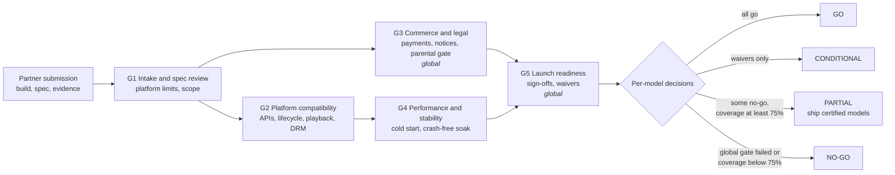

# streaming-partner-certification

A TV platform does not certify an app once. It certifies an app version on every model year, SoC, firmware train, and SDK version it ships to, and the answer is different on each one. A premium streaming app that runs cleanly on this year's flagship can blow the memory ceiling on a three-year-old entry model, lose DRM renewal on a firmware train that is only half rolled out, or ship a parental gate nobody ever tested. At platform scale the cost of getting that wrong is not one bug: it is a support spike across millions of living rooms and a partner relationship that takes a year to repair. This repository is how I would run that certification gate today: the program artifacts that make the go/no-go call defensible, and a small engine that turns raw test evidence into per-model decisions and a launch readiness report.

Draws on eight years running partner certification on a Smart TV platform (100M+ devices during my tenure). Everything here is a generalized reconstruction; all partners, models, and data are fictional.

**Live demo:** https://deokhwajeong.github.io/demos/partner-certification/



## How the gate works

Five gates, each with named signers and exit criteria. Decisions are made per TV model, then rolled up to a partner recommendation.



Per model:

| Condition | Decision |
|---|---|
| Model year not targeted, or SDK below the app minimum | `n/a` (out of scope, not a failure) |
| Failing blocker; failing major without a valid waiver; blocker or major with no evidence | `no-go` |
| No blocking failure, at least one valid waiver | `conditional` |
| Otherwise (minor failures ship as known issues) | `go` |

The rules that matter most in practice, all enforced in code and tests:

- **No evidence, no pass.** A test without a record is a blocking not-run.
- **Platform limits are settled at intake.** Memory and capability checks run from the partner's declared spec at G1, before any test money is spent, and they are blockers.
- **Blockers are never waivable.** Waivers have an owner, an expiry, and a mitigation; an expired waiver counts as none.
- **Global gates block the whole launch.** A legal or sign-off failure on one model is a failure everywhere.
- **Blocking issues rank by reach.** The readiness review starts with the defect that holds back the most models.

## What's in docs/

| Document | Use it for |
|---|---|
| [certification-playbook.md](docs/certification-playbook.md) | Entry and exit criteria per gate, evidence, signers, decision rules, operating rhythm |
| [launch-readiness-review.md](docs/launch-readiness-review.md) | Template for the one meeting that makes the call |
| [risk-register.md](docs/risk-register.md) | Scoring, template, and a worked example from the example data |
| [escalation-matrix.md](docs/escalation-matrix.md) | Levels, triggers, response times, and a five-line escalation memo |
| [spec-negotiation-guide.md](docs/spec-negotiation-guide.md) | Saying no early with the platform limit attached, and the two options to bring |
| [migration-revalidation-plan.md](docs/migration-revalidation-plan.md) | OS or SDK migration where every live app must re-pass |
| [postmortem-template.md](docs/postmortem-template.md) | Blameless review that ends in a test plan change |

## The engine

`src/partner_cert` is a small Python 3.12 package (one dependency: PyYAML). Inputs live in `examples/data`:

| File | Contents |
|---|---|
| `models.yaml` | 40 fictional TV models across 2024 to 2026: tier, SoC, firmware, SDK, resolution, HDR, per-app memory limit. The 2024 line is mid-migration from firmware 6.3 to 6.4. |
| `test_plan.yaml` | Gates, test cases (result, metric, spec, and sign-off kinds), applicability rules, severities, and policy (launch coverage floor, waivable severities) |
| `submissions/*.yaml` | 6 fictional partner apps: declared spec, target model years, scoped findings, measurements, waivers, sign-offs |

Findings, measurements, and waivers are scoped to the models they affect (`soc`, `tier`, `model_year`, `firmware_lt`, `sdk_gte`, explicit model ids), which is how real defects behave: a DRM bug on one SoC and one firmware train, not "the app is broken".

The example data deliberately produces every outcome:

| Partner | Result | Why |
|---|---|---|
| Aurora Stream | GO | Clean on all 40 models |
| Brightline Sports | CONDITIONAL | Entry tier cold start over threshold, under a time-boxed waiver; 2024 models out of scope (SDK floor) |
| Cinder Films | PARTIAL | DRM renewal defect on pre-6.4 firmware, back-key defect on 2026 mid tier; ships on 31 of 40 |
| Driftwood Kids | NO-GO | Parental gate evidence missing, legal sign-off outstanding (global gates) |
| Ember Music | GO | Minor UX issues recorded as known issues |
| Fathom Originals | NO-GO | Declared memory exceeds the entry tier limit on 13 models; coverage below the floor until the spec is renegotiated |

## How to run

```bash
python -m venv .venv && source .venv/bin/activate
pip install -e ".[dev]"

# Launch readiness report (Markdown to stdout)
partner-cert evaluate examples/data

# Write report.json and report.md
partner-cert evaluate examples/data --out out/

# Why is this model no-go for this partner?
partner-cert explain examples/data --partner cinder-films --model TV24-E43A

# Use as a CI gate: exit 2 if any partner is NO-GO
partner-cert evaluate examples/data --strict --format json > /dev/null

# Build the dashboard from real engine output into demo/dist/
python demo/build.py
```

`report.json` carries the summary, per-partner recommendation and gate status, the full partner x model matrix with reasons, ranked blocking issues, and active waivers with days remaining. The dashboard reads exactly that file.

## Tests

```bash
pytest          # 42 tests
ruff check . && ruff format --check .
```

Tests are organized by gate (`tests/test_g1_intake.py` through `tests/test_g5_launch_readiness.py`), and each test names the playbook exit criterion it enforces, for example `test_g1_1_memory_failure_cannot_be_waived` or `test_g5_2_expired_waiver_counts_as_no_waiver`. CI (GitHub Actions) runs lint, tests, the example report, and the demo build on Python 3.12.

## Layout

```
docs/                 program artifacts (playbook, templates, plans)
src/partner_cert/     engine: loader, scope matching, decision rules, reports, CLI
examples/data/        fictional model matrix, test plan, partner submissions
tests/                pytest suite mapped to gate exit criteria
demo/                 dashboard source and build script
```

## License

MIT. See [LICENSE](LICENSE).
